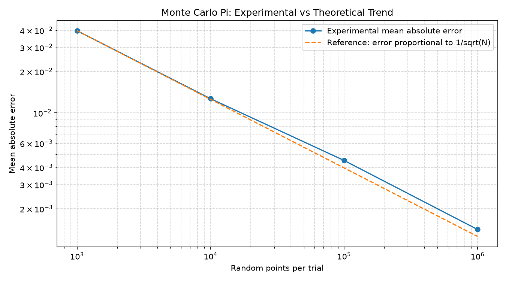
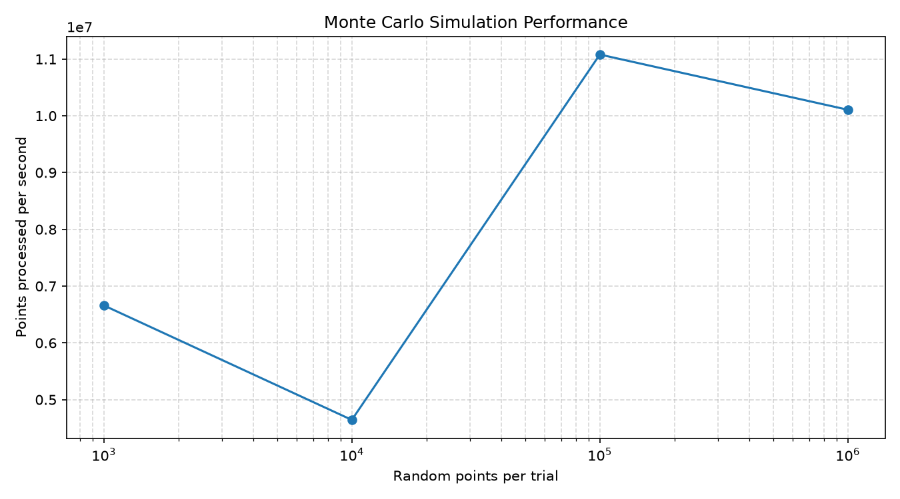

# Monte Carlo Simulation Lab

A C++ project that estimates the value of π using Monte Carlo simulation, analyzes statistical error across different sample sizes, and benchmarks simulation performance.

## Features

- Estimates π using randomly generated points.
- Runs repeated trials for statistical analysis.
- Compares different sample sizes.
- Calculates mean estimate and mean absolute error.
- Measures execution time and throughput.
- Exports experimental results to CSV.
- Visualizes accuracy and performance using Python and Matplotlib.

### How It Works

The program estimates the value of Pi using the Monte Carlo method.

1. Generate random points (x, y) inside the square [-1, 1] x [-1, 1].
2. Check whether each point lies inside the circle using:

   x*x + y*y <= 1

3. Count the points inside the circle.
4. Calculate the estimate of Pi using:

   Pi estimate = 4 * (points inside circle / total points)

### Statistical Calculations

**Mean Estimate**

Mean Estimate = Sum of all Pi estimates / Number of trials

**Absolute Error**

Absolute Error = |Estimated Pi - Actual Pi|

Actual Pi = 3.141592653589793

**Mean Absolute Error**

Mean Absolute Error = Sum of absolute errors / Number of trials

**Average Execution Time**

Average Execution Time = Total execution time across trials / Number of trials

**Throughput**

Throughput = Points per trial / Average execution time

Throughput is measured in points per second.

### Monte Carlo Error Relationship

The typical estimation error decreases approximately in proportion to:

Error ~ 1 / sqrt(N)

where N is the number of random points used in each trial.

For example, increasing the sample size by 100 times generally reduces the typical error scale by about 10 times. Actual results vary because the points are randomly generated.

## Visual Results

### Accuracy Analysis



### Performance Analysis



## Tech Stack

- C++
- Standard C++ library
- Python
- Matplotlib
- CSV

## Project Structure

```text
MonteCarloLab/
├── main.cpp
├── simulation.h
├── simulation.cpp
├── statistics.h
├── statistics.cpp
├── plot_results.py
├── plot_performance.py
├── comparison.csv
├── accuracy_comparison.png
├── performance_plot.png
├── README.md
└── .gitignore
```

## Build and Run

Compile the C++ source files:

```bash
g++ -std=c++11 -O2 main.cpp simulation.cpp statistics.cpp -o MonteCarloLab
```

On Windows, run:

```powershell
.\MonteCarloLab.exe
```

Enter the number of trials and the starting sample size when prompted.

## Python Visualization

Install Matplotlib:

```bash
python -m pip install matplotlib
```

Generate the accuracy and performance plots using the provided Python scripts:

```bash
python plot_results.py
python plot_performance.py
```

## Learning Objectives

- Monte Carlo methods and probability.
- Statistical error analysis.
- C++ functions, structures, and modular design.
- File handling and CSV data export.
- Performance measurement and data visualization.

## Future Improvements

- Reproducible random seeds.
- More robust benchmark statistics.
- Automated tests.
- Comparison with theoretical error rates.
